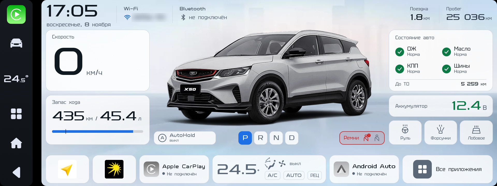
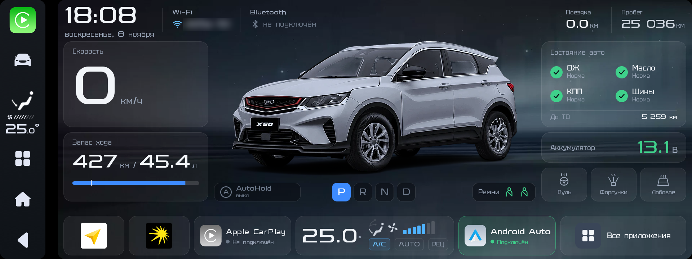

# BG Car Home

Свой главный экран для штатной магнитолы **Belgee X50** (Geely Coolray, SX11). Показывает данные машины в реальном времени, управляет подогревами и климатом, запускает CarPlay и Android Auto.

Сделано для себя и бесплатно. Автор — Станислав Игнатович.

| День | Ночь |
|---|---|
|  |  |

> Это неофициальный проект. Он не связан с Belgee, Geely или ECARX. Всё, что вы ставите на магнитолу, вы делаете на свой риск.

## Что умеет

**Данные машины, вживую**
- скорость, передача (P R N D), запас хода и топливо в литрах;
- пробег и пробег за поездку, километры до ТО;
- напряжение аккумулятора с порогом по состоянию мотора (11,8 В заглушен, 12,0 В работает);
- состояние ОЖ, масла, КПП и шин по предупреждениям приборки;
- ремни водителя и пассажира;
- открытые двери, багажник и капот;
- AutoHold: выключен, готов, держит.

**Управление**
- подогрев руля, форсунок омывателя и лобового стекла кнопками на экране;
- плитка климата: температура, обдув, вентилятор, A/C, AUTO, рециркуляция; по нажатию открывает штатный климат.

**Телефон**
- Apple CarPlay — статус подключения на плитке, запуск по нажатию;
- Android Auto через [Open Headunit](https://github.com/andreknieriem/open-headunit) — статус на плитке («Подключение…», «Подключён», «Нет связи»), запуск по нажатию.

**Внешний вид**
- дневная и ночная тема; авто-переключение по восходу и закату (сигнал день/ночь машины на этой модели не работает);
- ручной выбор темы: долгое нажатие на дату переключает «Авто → День → Ночь»;
- шрифт магнитолы GEELY с добавленной кириллицей (Tektur, OFL);
- полноэкранный режим, без верхней строки состояния.

**Запись поездок** (необязательно, для отладки и новых сигналов)
- долгое нажатие на часы включает и выключает запись, сверху появляется красная метка «● Запись данных»;
- подробности и безопасность — в разделе [Запись поездок](#запись-поездок).

Пасхалка: 7 быстрых нажатий на часы.

## Системные требования

| | |
|---|---|
| Автомобиль | Belgee X50 (проверено), скорее всего Geely Coolray SX11 с той же магнитолой |
| Магнитола | ECARX IHU730P, Android 9, экран 1920×720 |
| Прошивка | проверено на Lunaris 2.01 |
| Root | Magisk — нужен, чтобы поставить приложение системным (priv-app) |
| Компьютер | ADB по Wi‑Fi или USB для установки |

Почему нужен root: данные машины и управление подогревами доступны только системным приложениям с правами `CAR_VENDOR_EXTENSION` и `CONTROL_CAR_CLIMATE`.

Для Android Auto дополнительно нужен [Open Headunit](https://github.com/andreknieriem/open-headunit) 3.5.0 (ставится обычным приложением) и Android‑телефон с Android Auto.

## Установка

1. Скачать `bg-car-home-magisk-module.zip` со страницы [Releases](../../releases). В нём уже лежит APK.
2. Скопировать zip на магнитолу и установить в приложении Magisk → Модули. Перезагрузить.
3. Нажать «Домой» и выбрать BG Car Home главным экраном.

Обновление без перезагрузки: `adb install -r bg-car-home-1.0.0-release.apk` (APK тоже есть в Releases). Модуль нужен только при первой установке и когда приложению добавляются системные права.

Откат: удалить модуль «BG Car Home launcher» в Magisk и перезагрузить. Штатный лаунчер остаётся на месте.

## Запись поездок

Запись нужна, чтобы находить и расшифровывать новые сигналы машины. По умолчанию выключена.

- **Как включить:** долгое нажатие на часы. Если оставить запись включённой, после перезагрузки магнитолы она продолжится; выключили — после перезагрузки не включится.
- **Кто может включить:** только само приложение. Служба записи закрыта для других приложений.

- **Что пишется:** изменения сигналов машины (скорость, передача, двери, климат, подогревы, предупреждения и т. п.) с отметкой времени.
- **Что не пишется никогда:** VIN, ICCID, IMEI, MAC Bluetooth, координаты GPS. Эти сигналы отфильтрованы в коде (`PRIVATE_PROPS`).
- **Где лежит:** `/sdcard/Android/data/by.carhome/files/drive-ГГГГММДД-ЧЧММСС.csv`, новый файл на каждое включение зажигания.
- **Куда отправляется:** никуда. Приложение не ходит в интернет. Файлы забираете только вы, через ADB.
- **Как удалить:** удалить файлы в этой папке или удалить приложение.

## Что не проверено

- AutoHold: состояния «готов» и «держит» расшифрованы по одной поездке, нужна повторная проверка.
- Капот: сигнал найден, открытие капота не записано.
- Ремень пассажира: как ведёт себя датчик, когда на сиденье никого нет.
- Android Auto: работает, но по USB бывают обрывы связи (на одном кабеле; другой кабель не проверен). Беспроводной режим не проверен.
- Другие комплектации, прошивки и Geely Coolray.
- Сборка релиза на GitHub Actions ещё не запускалась.
- Последняя версия записи (закрытая служба, автозапуск только если запись оставили включённой) собрана, но на магнитоле не проверена.

## Известные проблемы

- Кнопка «Домой» на системной полоске открывает штатный лаунчер, а не BG Car Home.
- Штатное приложение QDLink (Q‑Drive Link) перехватывает Android‑телефон по USB. Его нужно отключить (`pm disable-user`), но после перезагрузки оно всё равно запускается и иногда мешает Android Auto.
- Системная полоска слева не переключается на светлую тему.
- Нет датчика наружной температуры, оборотов и мгновенного расхода — на шине магнитолы их нет или они не читаются.

## Планы

- Модуль LSPosed: кнопка «Домой» → BG Car Home, отключение верхней шторки, без всплывающих подсказок CarPlay.
- Надёжно убрать QDLink.
- Светлая тема для системной полоски.
- Пресеты климата «Лето» и «Зима» при удалённом запуске.
- Синхронизация дня и ночи с Android Auto.
- Локализация: русский, английский, китайский, малайский. Язык выбирается при сборке.
- Тесты (unit, скриншоты день/ночь, прогон записанных поездок) и CI.
- Улучшенные картинки машины.

## Сборка и разработка

- Kotlin, Android Gradle Plugin, JDK 17. Без сторонних библиотек в приложении.
- API машины ECARX (`com.ecarx.xui.adaptapi`) и VHAL вызываются через reflection, поэтому проект собирается без SDK производителя.
- Сборка: `gradlew assembleRelease` → `app/build/outputs/apk/release/bg-car-home-1.0.0-release.apk`.
- `magisk/` — модуль Magisk без APK. Чтобы собрать его вручную, положите APK в `magisk/system/priv-app/BGCarHome/BGCarHome.apk` и запакуйте содержимое папки в zip.
- Релиз собирает GitHub Actions (`.github/workflows/release.yml`) по тегу `v*`: APK и модуль Magisk прикладываются к релизу. Свой ключ подписи задаётся секретами `CARHOME_KEYSTORE_BASE64`, `CARHOME_KEYSTORE_PASSWORD`, `CARHOME_KEY_ALIAS`, `CARHOME_KEY_PASSWORD`; без них APK подписывается отладочным ключом.

## Лицензия

Код — [MIT](LICENSE).

Сторонние материалы не подпадают под MIT, они перечислены в [NOTICE](NOTICE):
- картинки из прошивки магнитолы (Geely, ECARX);
- значок Android Auto — товарный знак Google; Apple CarPlay — товарный знак Apple;
- фото автомобиля;
- шрифт GEELY (Geely) и Tektur ([SIL OFL 1.1](licenses/Tektur-OFL.txt)).
